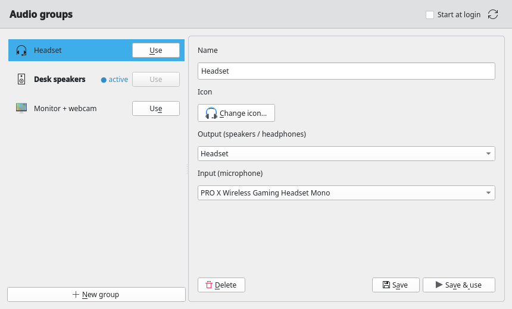
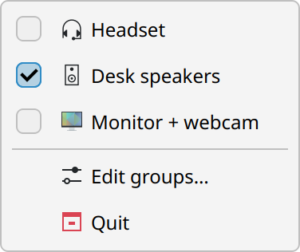
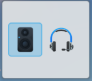

# Audio Switcher

Switch your audio **output and microphone together** with one click. Built for **KDE Plasma on Fedora**: a system tray icon, a native-looking group editor, and a Plasma panel widget.



Tray menu, with the active group checked:



Plasma widget:



## Features

- **Groups:** bundle an output device and an input device (for example headset + headset mic, or speakers + webcam mic).
- **One-click switching** from the tray menu, the Plasma widget, the app window or the command line.
- **Follows system defaults:** switching sets the default output and input, so apps that use the default device follow along.
- **Custom icons** per group, shown in the tray, the widget and the app.
- **Plasma widget** with a list view and an icons-only view for slim panels.
- **Notification** on every switch, with a warning if a device in the group is unplugged.
- **Runs in the tray:** closing the window keeps it running. Optional start at login.
- Plasma look via `qqc2-desktop-style` (falls back to Fusion if it isn't installed).

## Requirements

- Fedora with KDE Plasma 6 and PipeWire (or PulseAudio)
- Python 3.10+ and PySide6
- `pactl` (`pipewire-utils`), `notify-send` (`libnotify`)
- `qqc2-desktop-style` for the native Plasma look (recommended)

```bash
sudo dnf install python3-pip libnotify pipewire-utils qqc2-desktop-style
```

## Install

```bash
git clone https://github.com/Mosh-85/Audio-switcher.git
cd Audio-switcher
./install.sh
```

This installs the app and menu entry for your user and registers the Plasma widget. Make sure `~/.local/bin` is in your `PATH`.

Start it with `audio-switcher` (or from the application menu). Tick **Start at login** in the window to autostart it.

### Add the widget

Right-click the desktop or a panel, choose **Edit Mode → Add Widgets**, and search for **Audio Switcher**. To show only icons, right-click the widget, choose **Configure** and tick **Show only icons**.

### Updating

Remove the widget from your panel first, then run `./install.sh` again and restart the app (tray menu → Quit, then start it again). Replacing a widget while Plasma has it loaded can hang plasmashell.

## Usage

1. Click **New group**, give it a name and pick an icon.
2. Choose the output and input device (or "Don't change" for either).
3. **Save**, or **Save & use** to switch immediately.
4. Switch groups from the tray menu, the widget, or the **Use** button.

Closing the window sends the app to the tray. Left-click the tray icon to reopen it.

### Command line

Handy for keyboard shortcuts (System Settings → Keyboard → Shortcuts → Add Command):

```bash
audio-switcher-ctl list                 # groups and the active one, as JSON
audio-switcher-ctl apply "Headset"      # apply by name or id
```

Groups are stored in `~/.config/audio-switcher/groups.json`.

## Development

```bash
python3 -m audioswitcher.app            # run from the source tree
python3 -m unittest discover -s tests   # run tests
```

Test the widget in an isolated window instead of your live shell:

```bash
plasmawindowed org.audioswitcher.widget
```

## Project layout

| Path | Purpose |
|------|---------|
| `audioswitcher/audio.py` | `pactl` wrapper (list/set default devices) |
| `audioswitcher/config.py` | Group storage and applying a group |
| `audioswitcher/cli.py` | `audio-switcher-ctl` command |
| `audioswitcher/app.py` | Tray icon and app backend |
| `audioswitcher/qml/Main.qml` | Group editor UI |
| `plasmoid/org.audioswitcher.widget/` | Plasma widget |

## License

GPL-3.0. See [LICENSE](LICENSE).
